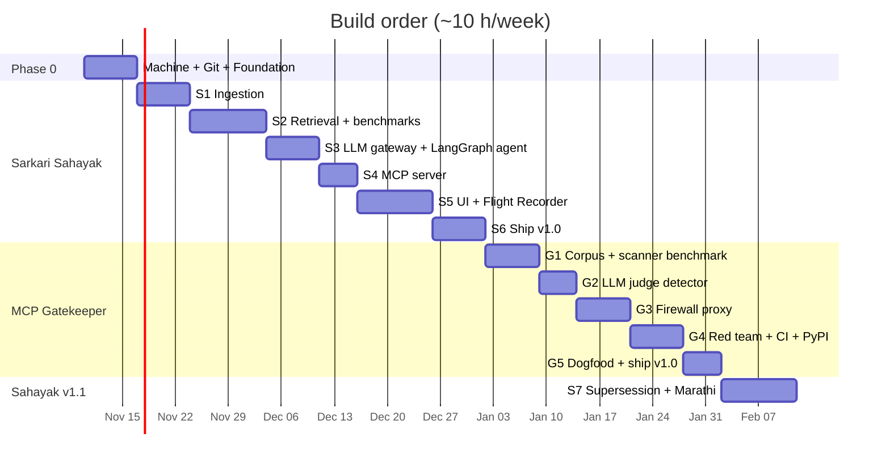

# Implementation Guide — "Agents that are measured, secure, and work in Hindi"

Two production-grade, open-source AI-engineering projects, built from scratch with TDD:

| Repo | Display name | One-line pitch |
|---|---|---|
| `sarkari-sahayak` | **Sarkari Sahayak** (सरकारी सहायक) | A bilingual (Hindi/English, Marathi in v1.1) agentic-RAG **MCP server** over RBI regulations that cites every answer — or refuses. Ships with a "Flight Recorder" that turns failures into CI regression tests. |
| `mcp-gatekeeper` | **MCP Gatekeeper** | A firewall for MCP tools: benchmarked poisoned-tool detection (incl. Hindi/Hinglish attacks), a pinning + validation + PII-redaction proxy, red-teaming, and a GitHub Action that blocks poisoned tools in PRs. |

Guide version: **2026-11-09**. Author of the plan: you (Priyanshu Raj, GitHub `Priyanshu-raj04`), with Claude.

---

## How to read this guide

Read in this order. Each file is self-contained enough to paste into Cursor as context.

| # | File | What it gives you | When |
|---|---|---|---|
| 1 | [`01-locked-decisions.md`](01-locked-decisions.md) | Every decision we made, what changed since the original research report, pinned versions | Before anything |
| 2 | [`02-machine-setup.md`](02-machine-setup.md) | One-time setup of your M1 / 8 GB Mac | Phase 0 |
| 3 | [`03-git-and-github-setup.md`](03-git-and-github-setup.md) | SSH + signed commits, repo creation, rulesets, labels, milestones, Projects board, templates | Phase 0 |
| 4 | [`04-engineering-foundation.md`](04-engineering-foundation.md) | The shared repo skeleton: uv, Ruff, Pyright, pytest, pre-commit, Makefile, Docker, CI, devcontainer, Cursor rules, ADRs | Phase 0 (per repo) |
| 5 | [`05-testing-strategy.md`](05-testing-strategy.md) | TDD loop, test pyramid, cassettes, integration/e2e, coverage gates, full e2e scenario catalogue | Read before S1, keep open |
| 6 | [`sahayak/00-story-and-architecture.md`](sahayak/00-story-and-architecture.md) | **The story of Sahayak**, architecture, data model, repo layout | Before S1 |
| 7 | `sahayak/S1-ingestion.md` · `S2-retrieval-and-benchmarks.md` · `S3-agent.md` · `S4-mcp-server.md` · `S5-ui-and-flight-recorder.md` · `S6-ship.md` · `S7-v1.1-supersession-and-marathi.md` | Milestones | Weeks 1–8, then after Gatekeeper |
| 8 | [`gatekeeper/00-story-and-architecture.md`](gatekeeper/00-story-and-architecture.md) | **The story of Gatekeeper**, threat model, architecture | Before G1 |
| 9 | `gatekeeper/G1-corpus-and-scanner-benchmark.md` · `G2-llm-judge.md` · `G3-firewall-proxy.md` · `G4-redteam-ci-pypi.md` · `G5-dogfood-and-ship.md` | Milestones | Weeks 9–14 |
| 10 | [`99-verification-log.md`](99-verification-log.md) | Every claim from the original report and the research report → status and evidence; bugs caught; open items | Whenever in doubt |
| 11 | `reference/` (in the zip) | The two reference repos the ✅ code was copied from, for diffing **after** you've written your own version | Never copy wholesale |

## Trust legend (used everywhere)

| Mark | Meaning |
|---|---|
| ✅ | **Verified in sandbox**: the exact package versions were installed and the code/tests were run (2026-11-09/10). Every code block marked ✅ is copied *automatically* from a reference repo whose test suite passed, so the guide and the tests cannot drift apart. |
| 📚 | **Verified from a primary source** (official docs, PyPI, GitHub releases). Link in `99-verification-log.md`. |
| ⚠️ | **Verify at setup** — could not be confirmed (site blocked, behaviour version-dependent, or depends on your account). The guide tells you exactly how to check, and gives a fallback. |

Nothing in this guide is meant to be taken on faith. Where a ⚠️ appears, your **first task in that step is to verify it** and record the answer in the repo's `docs/data-sources.md` or an ADR.

## What was actually run (so you know what to trust)

| Repo | Tests | Coverage | Gates |
|---|---|---|---|
| sarkari-sahayak (reference) | 89 unit/property/e2e tests passed; 6 integration tests passed against a real PostgreSQL + pgvector server (the ParadeDB BM25 test correctly skipped: no ParadeDB/Docker in the sandbox) | 83 % total (unit+e2e run); 99 % on `retrieve/` + `agent/` | ruff ✅ format ✅ pyright ✅ (one unresolved import: `sentence_transformers`, because the heavy `ml` extra wasn't installed in the sandbox) |
| mcp-gatekeeper (reference) | 43 passed (incl. HTTP dogfood e2e) | 97 % total; 96 % on `pii/` + `proxy/` + `detectors/` | ruff ✅ format ✅ pyright ✅ (0 errors); wheel builds and its CLI runs via `uvx` ✅ |

Not run in the sandbox (needs your Mac or network the sandbox lacks): Docker builds, ParadeDB BM25, Ollama models, Hugging Face downloads (MIRACL, e5, rerankers), real OCR, Render/Neon/Streamlit deployments, promptfoo runs, external scanners. Those steps are marked ⚠️ with a check to perform.

## Milestone map

Dates are illustrative; there is no deadline. A milestone is "done" only when its **Definition of Done** checklist is green.

## The working loop for every milestone (industry standard)

1. Open the milestone's GitHub **Issue** (text is provided in each milestone file).
2. `git switch -c feat/<milestone>-<slug>`
3. Read the milestone's concept primers.
4. For each step: **write the failing test → run it red → implement → green → refactor** (see `05-testing-strategy.md`).
5. `make check` (lint + types + tests + coverage) locally.
6. Small conventional commits (`feat:`, `test:`, `fix:`, `docs:`, `chore:`).
7. Open a PR using the template; CI must be green; self-review the diff; **squash-merge**.
8. Update `CHANGELOG.md`; write an ADR if a design decision was made.

## Working with Cursor (and Claude)

* Each repo gets an `AGENTS.md` + `.cursor/rules/` (templates in `04-engineering-foundation.md`) that carry the project story, architecture and the TDD rule, so Cursor always has context.
* Each milestone ends with a **"Cursor prompt"** block you can paste to have Cursor scaffold the step — but the rule stands: *tests first, you review every line, and you must be able to explain it in an interview.*
* Your Mac is linked to this Claude session; when you connect a repo folder I can run `make check` on your machine and review diffs.
