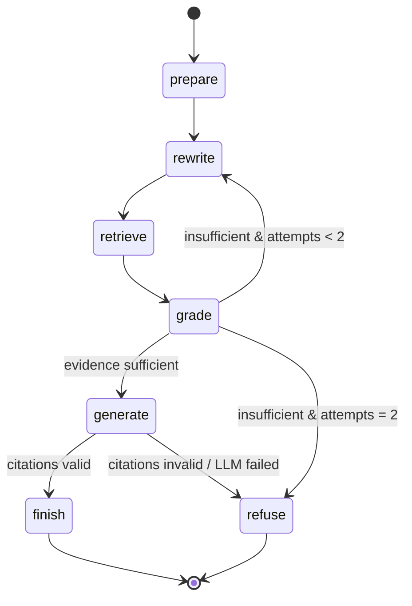
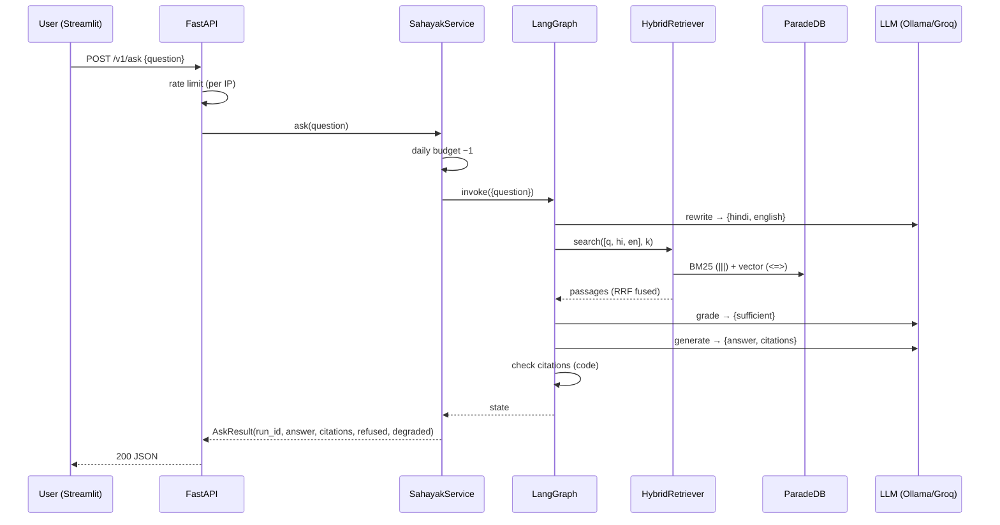
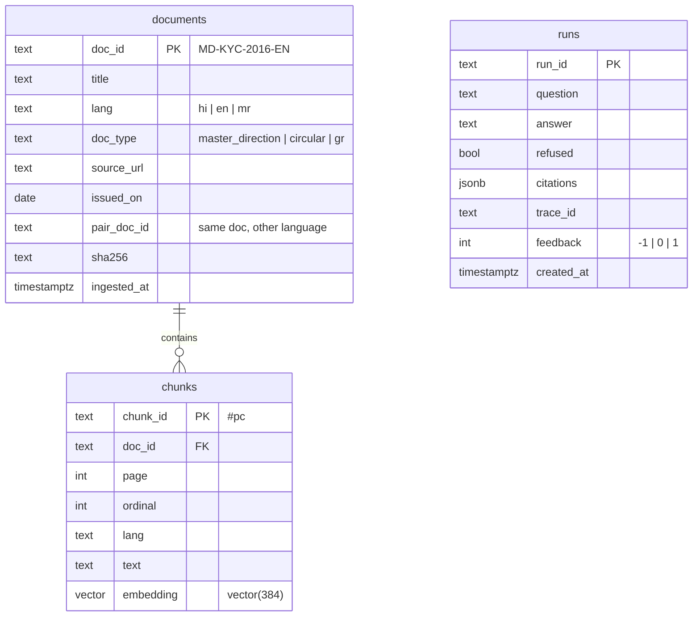

# Sarkari Sahayak — The Story & the Architecture

> Read this before writing any code. It is also the context file Cursor reads (`AGENTS.md` points here).

## 1. The story (how the system works, told as one afternoon)

**Meet Anjali.** She works on the compliance team of a small NBFC in Pune. Her manager asks:
*"नए ग्राहक के लिए वीडियो-KYC की अनुमति है क्या, और कौन-सा RBI नियम ये कहता है?"*
("Is video-KYC allowed for new customers, and which RBI rule says so?")

The answer is buried in the RBI *Master Direction – Know Your Customer (KYC) Direction, 2016*: a long PDF that has been amended many times, published in English and Hindi. Anjali's real need is not "an answer" but **an answer she can defend**: the exact paragraph, in the right language, with a link.

Here is what happens when she types that Hinglish question into Sarkari Sahayak:

1. **It reads the question carefully (`prepare`).** The text is Unicode-normalised (Hindi PDFs and keyboards produce the same letter in different byte forms) and the script is detected. Devanagari → she'll get a Hindi answer.
2. **It rewrites the question (`rewrite`).** A small local LLM (Qwen3-4B via Ollama on her laptop; Groq in the hosted demo) turns it into two clean search queries:
   *"वीडियो आधारित ग्राहक पहचान प्रक्रिया अनुमति"* and *"video-based customer identification process V-CIP permitted"*.
   The regulatory jargon is often clearer in English, the user's intent clearer in Hindi, so we search with both.
3. **It searches in three ways at once (`retrieve`).**
   * **BM25** (keyword search, in ParadeDB inside Postgres) finds paragraphs containing "V-CIP" and "वीडियो".
   * **Dense vectors** (multilingual-e5-small embeddings, in pgvector) find paragraphs that *mean* the same thing even with different words, including across languages: a Hindi query can find an English paragraph.
   * The rankings are fused with **Reciprocal Rank Fusion**: a paragraph that both methods like rises to the top. Optionally a **cross-encoder reranker** re-reads the top 30 and re-orders them.
4. **It checks whether it actually knows (`grade`).** The LLM is asked a strict yes/no question: *do these passages fully answer the question?* If not, it rewrites and searches once more. If it still can't find evidence, **it refuses** politely, in Hindi, rather than guessing.
5. **It answers, with receipts (`generate`).** The answer is written only from the retrieved passages, and every sentence carries a citation like `[MD-KYC-2016-EN#p37c2]`.
6. **It audits its own citations (`check_citations`).** Code, not the LLM, verifies that every cited id was really retrieved, that the answer cites at least one passage, and that the declared and inline citations match. A made-up citation means the answer is thrown away and the system refuses. This is the core promise: **cite or refuse**.
7. **Anjali sees the answer in the Streamlit app**, expands the cited paragraph, and clicks through to rbi.org.in. She clicks 👎 on a different question where the answer was in English instead of Hindi.
8. **The Flight Recorder kicks in.** Every run is traced in Phoenix (each graph step, each LLM call, latency). Her 👎 marks that run. Later, you run `sahayak golden add <run_id>`: the case becomes a permanent line in `evals/golden/golden.jsonl`. From now on, **every pull request** re-runs that question through the agent with a local LLM judge in GitHub Actions. If a future prompt change brings the bug back, the PR turns red.
9. **Meanwhile, in Cursor or Claude Desktop**, a developer's own AI agent connects to Sahayak as an **MCP server** and calls `search_docs`, `get_passage` and `verify_claim` directly. Sahayak isn't just an app; it's a *tool* other agents can trust.
10. **On the public internet**, the same server runs on Render's free tier, behind a rate limiter and a daily budget so strangers can't burn the free API quota. In v1.0 of MCP Gatekeeper (the second project), this public endpoint is served *through* Gatekeeper's firewall.

And the numbers that make this credible are in the README: **nDCG@10 on MIRACL-Hindi** for BM25 vs dense vs hybrid vs hybrid+rerank, **recall on IndicQA (Hindi, and Marathi in v1.1)**, the **refusal rate on NoMIRACL** (questions whose answer is *not* in the corpus), **faithfulness** on the golden set, and **judge agreement** between the small local judge and a stronger API judge.

## 2. Component view

```mermaid
flowchart TB
  subgraph Clients
    UI[Streamlit UI]
    CD[Claude Desktop / Cursor<br/>MCP clients]
    CURL[curl / REST]
  end
  subgraph API["FastAPI process (uvicorn)"]
    RL[RateLimitMiddleware<br/>token bucket per IP]
    REST["/v1/ask, /health"]
    MCP["/mcp — FastMCP 4<br/>search_docs · get_passage · verify_claim<br/>resource sahayak://docs/{id}"]
    SVC[SahayakService<br/>+ DailyBudget]
    G[LangGraph agent<br/>cite-or-refuse]
    HR[HybridRetriever<br/>RRF + optional rerank]
    GW[LiteLLMGateway<br/>fallbacks · JSON repair]
  end
  subgraph Data
    PG[(ParadeDB / Postgres<br/>documents · chunks<br/>pgvector + pg_search)]
  end
  subgraph Models
    OL[Ollama (Mac, Metal)<br/>qwen3:4b-instruct]
    GR[Groq / Gemini<br/>hosted]
    EMB[e5-small embedder<br/>(+ bge-m3, reranker in benchmarks)]
  end
  PX[Phoenix<br/>traces]
  UI --> RL
  CD --> RL
  CURL --> RL
  RL --> REST & MCP
  REST --> SVC
  MCP --> SVC
  SVC --> G --> HR
  G --> GW --> OL & GR
  HR --> PG
  HR --> EMB
  G -. OpenTelemetry .-> PX
```

## 3. The agent graph



## 4. Request sequence (REST)



## 5. Data model



`runs` arrives in S5 (Flight Recorder). Supersession fields (`superseded_by`, `amends`) arrive in S7.

## 6. Final repository layout (after S6)

```
sarkari-sahayak/
├── app/streamlit_app.py
├── data_manifest/rbi_manifest.csv      # URLs + sha256 of every source document (committed)
├── docs/{adr/, data-sources.md, guide/, results/}
├── evals/
│   ├── agreement.py                    # Cohen's kappa
│   ├── benchmarks/{trec.py, miracl.py, nomiracl.py, indicqa.py, run_retrieval.py}
│   ├── golden/golden.jsonl             # Flight Recorder regression cases
│   ├── test_regression.py              # DeepEval gate (marker: llm)
│   └── report.py                       # → GitHub Pages
├── infra/postgres/init/01-init.sql
├── src/sahayak/
│   ├── agent/{graph,prompts,schemas}.py
│   ├── api/{app,ratelimit}.py
│   ├── embed/e5.py
│   ├── flight/{golden,runs,tracing}.py
│   ├── ingest/{pdf,rbi,pipeline}.py
│   ├── llm/gateway.py
│   ├── mcp_server/server.py
│   ├── retrieve/{types,fusion,hybrid,bm25_memory,rerank}.py
│   ├── store/{repo,migrate}.py + migrations/*.sql
│   ├── text/{normalize,chunking}.py
│   ├── bootstrap.py                    # wires everything per Profile
│   ├── service.py  config.py  logging.py  cli.py
├── tests/{unit,integration,e2e,fixtures,cassettes}/ + conftest.py + fakes.py
├── Dockerfile  render.yaml  docker-compose.yml  Makefile  pyproject.toml  uv.lock
```

## 7. Design principles (each one is an interview answer)

| Principle | Where you see it | Why |
|---|---|---|
| **Ports & adapters** | `Retriever`, `PassageStore`, `LLMClient` protocols; Postgres/bm25s/Ollama are adapters | Swap ParadeDB↔bm25s or Ollama↔Groq per profile without touching logic; fakes make TDD easy |
| **Code checks the LLM, not the other way round** | `citations_valid()` | LLMs hallucinate citations; a set comparison doesn't |
| **Fail soft** | a failing retriever is skipped; LLM outage → `degraded` retrieval-only answer | Free tiers fail often; the demo should never crash |
| **Measure before claiming** | `evals/`, results tables with n | Interviewers ask "how do you know?" |
| **One service layer** | REST and MCP both call `SahayakService` | No duplicated business rules, budget applied once |
| **Everything versioned** | prompts (`PROMPT_VERSION`), golden set, cassettes, model tags, lockfile | Reproducible results |
